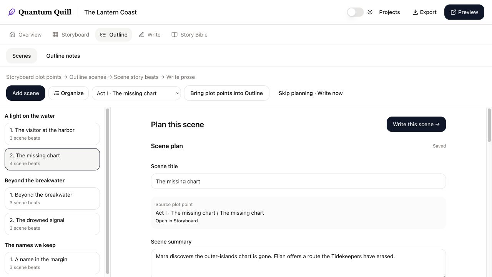
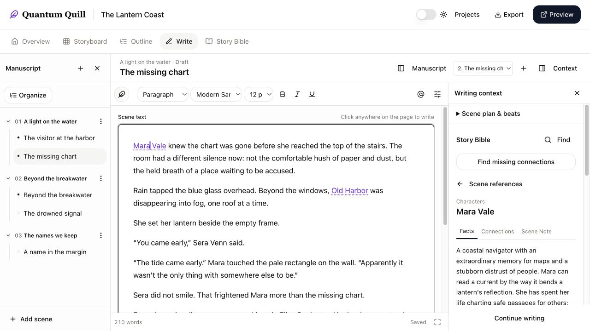

# Quantum Quill

### A world beside your writing.

Quantum Quill brings your manuscript, scene plans, characters, places, and research into one writing workspace. It is being built for novelists first: enough structure to keep a complex story coherent, with room to skip the planning and simply write.

[Explore the roadmap](https://drsurfbum.github.io/quantum-quill-roadmap/) · [Public introduction & feedback](https://github.com/drsurfbum/quantum-quill-roadmap) · [Alpha setup](docs/HOSTED_ALPHA.md)


**Status: open alpha.** [Try Quantum Quill](https://quantum-quill-alpha.onrender.com) and register a new account. The hosted alpha starts fresh; local accounts and private manuscripts were not copied. Screenshots below use a fictional demonstration project, *The Lantern Coast*. The roadmap and design study remain separate previews.

## Plan as much—or as little—as you need

**Storyboard plot points → Outline scenes → Scene story beats → Write prose**

Start with a guided New Project Wizard, choose a plot structure, and use the Blueprint Wizard to turn selected plot points into planned chapters and scenes. Add scene summaries and beats in the Outline, then move into prose. You can also start directly with a chapter or scene and plan later. Chapter-level drafts stay intact when you introduce scenes.



## Keep your world in the writing room

The Story Bible holds seven kinds of entries: **Characters, Groups & Races, Locations, Events, World Elements, Details, and Research**. Guided sections, relationships, backlinks, search, tags, and project images help turn a collection of notes into a usable reference.

Connect entries to a scene as its viewpoint character, cast, location, or reference material. Link an element inline in the prose and open its card beside the editor to check facts or edit notes without navigating away. The connection scanner finds mentions of **existing** entries and lets you review suggestions before adding links; it does not rewrite your prose or invent new characters.




## Write comfortably, keep control of your work

- Rich formatting: fonts, sizes, headings, lists, colors, alignment, images, tables, find/replace, and more.
- Quill styles inspired by literary moods, plus reusable custom styles saved to your account.
- Chapter and scene organization, a focus view, and light/dark themes.
- Autosave with server revisions, explicit conflict review, and account/project-scoped local draft recovery. Failed saves stay recoverable; recovery offers restore/discard choices.
- Export **Word, EPUB, HTML, plain text, or JSON**. Preview supports browser printing and Save as PDF.


Draft recovery is a safety net, not a complete offline application or a substitute for exports. Browser storage can be cleared; keep copies of important writing outside the alpha.

## Help test the alpha

[Open the alpha](https://quantum-quill-alpha.onrender.com), choose **Register**, and create an account. Begin with a sample story:

1. Create a project and add a character and a location to its Story Bible.
2. Plan a scene—or go straight to Write—and draft a few paragraphs.
3. Link an element inline, open its card, and try the connection scanner.
4. Change formatting, switch scenes, reload, and check that the writing remains as expected.
5. Export a copy and tell us what felt useful, confusing, or missing.

Use **Feedback** inside QQ to send a private bug report, confusing experience, or idea. Your account’s recent reports show receipt numbers and review status. Browser details and email follow-up are optional; manuscript text is never attached automatically. You can also [report public feedback](https://github.com/drsurfbum/quantum-quill-roadmap/issues). Include the steps you took and what you expected. Public issues are visible to everyone: use sample text and redact account details in screenshots. Report possible security or account-access problems privately to the maintainer through your tester contact channel, rather than posting sensitive details publicly.

**Alpha boundaries:** desktop/tablet layouts are the main focus. Email verification, password-reset email, and self-service account deletion are not yet available. Collaboration, AI generation, graph/timeline views, and the legacy whiteboard are not active features. Other storytelling formats—RPG campaigns, scripts, plays, and historical narratives—are future directions, not current promises.

## Run a fresh local instance

Requires **Node 24** and **PostgreSQL 16**. This source repository is private; cloning requires access.

```sh
npm ci --ignore-scripts
cp .env.example .env
# Set DATABASE_URL to a new, empty PostgreSQL database.
# Set SESSION_SECRET to a newly generated random secret.
node --env-file=.env scripts/init-alpha-db.mjs
node --env-file=.env --import tsx server/index.ts
```

The example configuration serves the app at `http://127.0.0.1:5055`. The initializer refuses existing data and can be rerun on its own unchanged schema. It is not a migration tool.

**On the existing recovery Mac:** continue using `Start Quantum Quill.command` or `npm run dev:local` and the [local setup guide](LOCAL_SETUP.md). Never run `db:push` or the fresh alpha initializer against recovered writing. Environment files, manuscripts, uploaded files, and database backups remain outside Git.

## For developers

React/TypeScript and TipTap provide the editor; Express, PostgreSQL, and Drizzle provide authenticated APIs, persistence, and transactional writes. A single Node service serves the built client and API.

| Area | Responsibility |
| --- | --- |
| `client/src/` | Workspace screens, editors, protected save queues, recovery UI |
| `server/` | Authentication, scoped APIs, revisions, planning, exports, upload access |
| `shared/` | Data contracts, field validation, taxonomy, relationships, writing styles |
| `deployment/` | Empty-database alpha schema; no user data |
| `docs/` | Design decisions, audits, recovery and deployment procedures |

```sh
npm run check
npm test
npm run build
```

See [testing](README-Testing.md), [hosted alpha operations](docs/HOSTED_ALPHA.md), [draft protection](docs/DRAFT_RECOVERY_AND_DATA_INTEGRITY.md), [scene connections](docs/SCENE_STORY_BIBLE.md), and the [data contract](docs/DATA_CONTRACT.md).

Completed features are checked, committed, and pushed to their feature branches. **Merging and deployment are separate decisions.** See [development workflow](docs/DEVELOPMENT_WORKFLOW.md). The original recovered records and backups remain the rollback point; history is preserved in the [restart audit](docs/RESTART_AUDIT.md) and [Antigravity comparison](docs/ANTIGRAVITY_COMPARISON.md).
