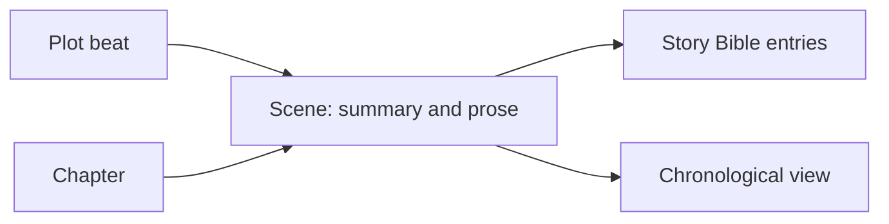

# Antigravity comparison and feature recovery

Reviewed October 11, 2026. Current application baseline: `588c610` on `codex/shared-relationships`.

**Keep the current application as the foundation and recover selected Antigravity features. Both wizards are requested restoration priorities.** Antigravity contains substantial later product work, especially a scene-based planning-to-writing workflow. It also contains unfinished persistence, demo authentication, hard-coded sample data, and incompatible data conventions. Replacing the stabilized application wholesale would reintroduce failures we have already addressed.

## Scope and evidence

- Current application: `/Users/austinhartt/Documents/GitHub/quantum-quill-app`.
- Antigravity source: `/Users/austinhartt/Documents/Antigravity/QuantumQuill AG`.
- Inspected routed pages, their components and imports, both wizard implementations, schemas, API handlers, save paths, settings/export logic, AI/context services, taxonomy catalogs, dependency manifests, and build configuration.
- This is a source audit. “Implemented” below means a connected implementation exists in source, not that it passed a browser or database round trip. No Antigravity server, seed, reset, migration, or database connection was started. No existing writing or original Antigravity files were changed.
- Antigravity has no Git repository at this folder or its ancestors. Its `walkthrough.md` describes a reference-based rewrite and is older than much of the code: the backend is no longer just the placeholder described there.
- A read-only frontend TypeScript check (`tsc --noEmit --incremental false -p tsconfig.app.json`) produced no diagnostics and did not complete after about three minutes; it was stopped. Compilation is **unverified**, not a pass or a confirmed compiler failure. The configured TypeScript projects include client/shared and Vite configuration, but omit `server/`.
- No automated application test suite or test script was found in Antigravity. Root database probe scripts are not a regression suite. The current application's previously verified 293 tests were not rerun for this documentation-only audit.

## What Antigravity adds

| Capability | Evidence and completeness | Difference from current app |
| --- | --- | --- |
| New Project Wizard | `CreateProjectWizard.tsx`, opened from `LibraryPage.tsx`. Two steps collect title, author, genre, target word count, and logline; POST creates the project, then opens the planning workspace. | Current dashboard creates a generic “New Project” immediately. No setup wizard or author/genre/goal project fields. |
| Blueprint Wizard | `BlueprintWizard.tsx`, `BeatExpander.tsx`, `ChapterPacker.tsx`. Walk through each plot beat, add/edit scene titles and summaries, then insert chapter breaks and create chapters/scenes. Connected through “Send to Outline” and the empty-outline launchpad. | No equivalent conversion workflow or scene records. Preserve the interaction, replace the persistence logic. |
| Scene-based manuscript | `ManuscriptPage.tsx`, `SceneNavigator.tsx`, `RichTextEditor.tsx`, `scenes` table, book/scene APIs. Scene prose and summary are separate. Scene metadata and a plot-beat reference connect planning to writing. | Current Write edits chapter prose. Outline records and plot sections are separate tools. |
| Narrative Architect | `NarrativeArchitectPage.tsx`, `StructureGallery.tsx`, `BeatCard.tsx`. Seven familiar structure templates, beat guidance, location/conflict/emotion notes, and active structure switching. | Current already has eight templates, including freeform. Recover presentation and the planning-to-scenes connection; this is not seven newly discovered plotting methods. |
| Chapter/scene outliner | `ColumnOutliner.tsx`, `SceneInspector.tsx`. Three columns for chapters, scenes, and detail; create scenes, edit summaries, link beats, open Write, move scenes between chapters. | Current outline is a generic hierarchical tree. Antigravity's chapter reorder and within-chapter scene reorder only update local state; they are not persisted. |
| Manuscript links and context | TipTap mentions in `RichTextEditor.tsx`, `MentionList.tsx`, `ContextSidebar.tsx`, `EntityScanner.tsx`. Clickable character/location references, cast/context sidebar, and suggested entity matches. | Current shared links work inside the Story Bible, but do not yet connect manuscript passages/scenes to entries. Antigravity mixes real IDs with Star Wars seed IDs and hard-codes project 1 in several paths. |
| Chronos Timeline | `TimelinePage.tsx`, `EventEditor.tsx`, timeline CRUD and `timeline_events`. Free-form fictional dates, scene/lore filtering, before/after positioning, character and scene links. | Current has Story Bible Events and relationships, but no dedicated chronological workspace. Antigravity duplicates event storage; integration should reuse the current Event contract. Fractional ordering in the UI conflicts with the integer DB sort column. |
| Export Station | `ExportConfig.tsx` really builds PDF, DOCX, and Markdown files from chapters/scenes, with title/author and manuscript-style presets. | Current export dialog still simulates completion. Antigravity export flattens rich text to plain text, removes all `@` characters, and omits chapter prose outside scenes. EPUB is a placeholder. |
| Library and project settings | Book-cover project cards, author/logline/genres/cover/goal metadata, `ProjectMeta.tsx`, project read/update routes. | Current has a simpler project dashboard and no corresponding metadata editor. Some Library menu actions are unfinished or navigate without a project ID. |
| Writing dashboard | `Dashboard.tsx` and dashboard/activity endpoints: recent scenes/entities, daily word delta, resume card, completion and missing-detail counters. | More developed than current recent-activity placeholder. “AI Summary” is the saved scene summary; “open loops” and “lore gaps” are simple missing-field checks, not story analysis. Some resume links omit project IDs. |
| Command palette | `OmniBar.tsx`, mounted in `App.tsx`; Cmd/Ctrl+K page/entity/scene/timeline navigation and creation shortcuts. | No equivalent global palette. Entity/scene results are trimmed to recent/context items before searching, so it is not complete project search. Export and Muse affordances are incomplete. |
| World Codex presentation | Gallery density control, category filters, category board with drag/drop, reusable cards and collapsible generated forms. | Current uses seven specialized editors plus common form/link controls. Reuse useful display patterns while keeping the current validation and lossless readers. |
| Character development catalogs | `TraitConstellation.tsx`, `taxonomy-data.ts`, enhanced taxonomy: multiple archetypes, positive/negative traits, Ghost/Wound and The Lie. Searchable chips carry descriptions. | These dedicated controls/catalogs are missing from current character editing. Catalogs contain 12 archetypes, 5 positive traits, 5 negative traits, and 8 wounds. Enneagrams and Needs are defined but not referenced by the active taxonomy-multi form fields. |
| Muse assistance | Margin controls and `/api/muse` assemble scene, beat, and character context and return suggestions. | The interaction and context pipeline are prototypes worth studying. `AIService.generateResponse` always calls a canned-response generator; there is no real provider integration. Saved model/temperature/persona settings are not passed into it. |
| Import, backup and editor preferences | Notion HTML parser exists without a UI caller; JSON import is disabled. The JSON backup button targets a malformed path, with no matching export API found. Typography preferences use local storage. | Import/backup is unfinished. Typewriter scrolling is a stored toggle without an editor consumer. Focus mode adds a class without a matching stylesheet rule found in the reviewed source. Current Write already has richer formatting, saved styles and a working focus mode. |

## The architecture difference

Both remain TypeScript, React, Express, PostgreSQL, Drizzle and TipTap applications. There is no language rewrite to recover. Antigravity is a separate redesign using newer major library versions and a different manuscript model.

| Area | Current stabilized app | Antigravity |
| --- | --- | --- |
| Manuscript ownership | `chapters.content` holds writing. | `scenes.content` holds writing; scenes belong to chapters. `chapters.content` remains in the schema but is not the active manuscript/export source. |
| Planning | Database templates, integer template IDs, hierarchical outline items, plot sections. | Bundled template catalog, text template keys, one active plot structure, beat metadata, scene-to-beat links. |
| Data fetching/state | TanStack Query, React contexts, common account-aware request and save mechanisms. | Local React state and raw fetch; Zustand for manuscript and browser preferences. Zustand itself is not the problem; server-save coordination and account isolation are missing. |
| Save reliability | Serialized queues, durable account/project-scoped drafts, restore/discard, server revisions and conflict checks. | One-second scene debounce, in-memory manuscript state, separate fire-and-forget metadata writes. No durable writing journal or server revisions found. Wizard drafts also live only in memory. |
| API structure | Testable application/storage separation, common ownership/validation paths, dedicated relationship service. | Most handlers query Drizzle directly inside one routes file. Sparse validation and non-atomic multi-request workflows. |
| Authentication | Session-backed identity and project/resource ownership checks. | Development identity defaults to user 1 or accepts `x-dev-user-id`; only three listed routes use that middleware. Most resource routes have no authentication/ownership check. |
| Story Bible | Seven canonical types, catalog, type-specific validation, compatibility readers and reviewed conversion previews. Proposed version-2 content migration remains unapplied. | Generic form generator with nine taxonomy definitions, but ordinary Codex tabs/create controls expose four main types. Uppercase discriminators; Groups/Races split; Items/Languages/Magic Systems added; Details/Research missing. Category-specific World Element fields are defined but not consumed by the universal form. |
| Relationships | ID-based shared links, backlinks, safe stubs, same-project checks, versions, hierarchy checks, predictable archive/delete behavior. | Metadata fields/ID arrays and basic pickers. No shared relationship table or equivalent integrity service. |
| Images | Separate upload files and authenticated serving; further per-project storage hardening remains. | FileReader embeds base64 data URLs in metadata; Express allows 50 MB JSON payloads. This changes backup/response sizes and should not be copied as the storage plan. |
| Runtime | React 18, Express 4, Tailwind 3, Zod 3; integrated dev server and bundled server build. | React 19, Express 5, Tailwind 4, Zod 4; separate Vite proxy and Express port 5001. Build creates the frontend; backend packaging and checking need work. |

The scene relationship is the most valuable design change:

This is a useful direction for the current app, with explicit IDs and integrity checks. Antigravity's implementation is inconsistent: the planner uses `sectionKey` as a beat ID, while the context engine tries to parse it as a database row ID; plot saves match sections by their order. Copying those conventions would make links fragile.

## What to retain from the current application

Keep its writing protections, current seven-type Story Bible coverage, field-validation fixtures, shared relationships and safe conversion rules, richer Write formatting/saved styles, and existing writing data. Antigravity's generic renderer is a useful UI pattern, but its data handling does not supersede the current contract.

In particular, Antigravity's Bible updater replaces metadata, omits top-level prose from updates, and archives into metadata while retaining a separate archive column. These are the same kinds of split-source and lost-field problems the stabilization work addresses. Its character catalogs can be added without restoring these problems.

The Codex also exposes a “Seed Database” control that deletes the project's existing Bible entries and substitutes Star Wars fixtures after confirmation. Keep sample-data setup in isolated fixtures, rather than carrying that control into the writer's app.

## Requested wizard restoration sequence

1. **Restore New Project setup.** Keep title, author, genre, goal, logline and the planning handoff. Add validated project settings through an additive migration, scoped recoverable setup drafts, visible failure handling and retry-safe creation. Store the logline in the existing description field rather than creating conflicting copies. Normalize genre choices shared with project settings. Allow the writer to skip planning and start writing.
2. **Add scenes as an optional capability.** New scene records need chapter ownership, stable plot-section references, summary separate from prose, revision checks, common draft recovery, and links to Bible entries. Preserve existing chapter prose exactly. Existing chapters continue in chapter mode until an explicit previewed conversion is requested; new wizard-created chapters can use scene mode. Define which mode owns editable prose so chapter and scene copies cannot silently diverge. Scene conversion is not authorized as an in-place rewrite of recovered writing.
3. **Restore Blueprint Wizard on that foundation.** Retain beat-by-beat guidance, editable scene cards and chapter-break preview. Persist wizard progress by account/project/plot. Submit one transactional build with an idempotency key and checked source revision. Append explicitly to an existing project with a preview of names/order; never replace existing chapters or assume numbering starts at one. The old implementation sends independent POST requests and can leave a partial outline or duplicate a retry; scene responses are not checked.
4. **Connect planning to Write and finish ordering.** Navigate directly to the resulting chapter/scene, use the current editor, and save reorder/move operations atomically. Do not introduce the old scene debounce as a second save system.

Restoration acceptance: reload-safe wizard drafts; account-switch isolation; double-click/retry creates one result; injected failure creates no partial book; correct same-project links; stale preview rejected; saved order survives reload; current chapter prose unchanged; editor and field regression suites remain green. Use synthetic projects and a disposable database before adopting any schema addition locally.

## Other recovery priorities

After the wizards and scene foundation: restore real exports with formatting/punctuation fidelity, then manuscript entity links and scene context, then the chronological view built from existing Events. The command palette, character catalogs, dashboard and Codex presentation can be adapted independently in smaller changes. Treat real AI integration as separate work requiring an actual provider and tested context boundaries; the recovered Muse is a UI/context prototype.

The Antigravity source is a valuable feature reference. Its database must not be substituted for the current database, and its legacy payloads need their own compatibility mapping if any Antigravity writing is later imported. Existing recovered-data backups remain the rollback point.
