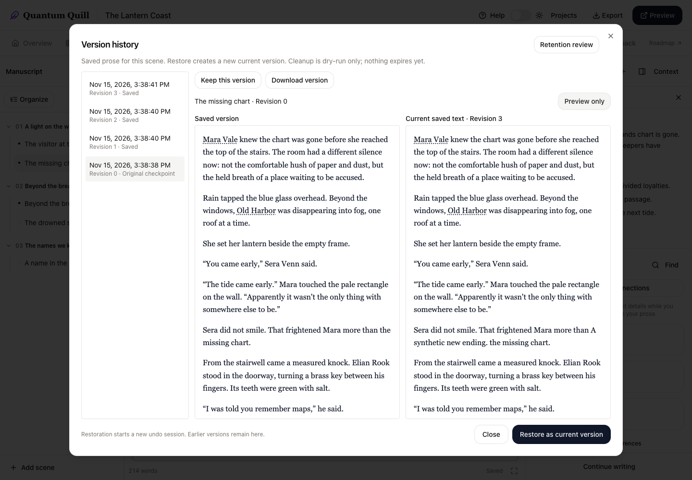
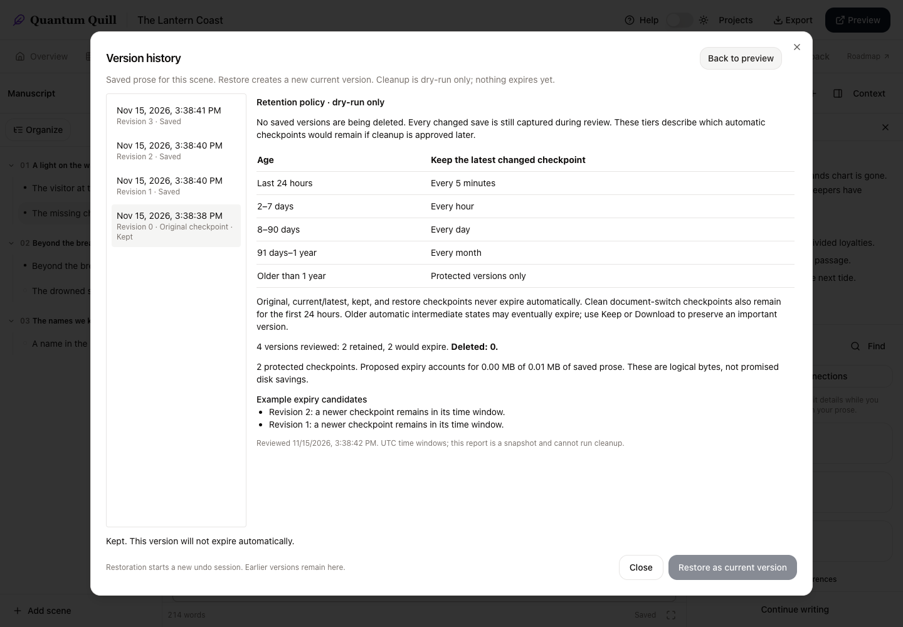

# Write: Undo/Redo and saved version history

Review candidate for QQ-31, based on release `d610409`. No live migration or deployment is part of this feature. Named alternate drafts remain separate.

## Writer behavior

Undo, Redo, and Version history are visible in the fixed-height Write toolbar. Undo/redo uses the native editor history, retains selection/focus, and continues across normal autosave acknowledgments. Cmd/Ctrl+Z undoes; Cmd/Ctrl+Shift+Z and Ctrl+Y redo. Commands apply to the focused editor, not text fields in a dialog. Navigation/reload and explicit saved-version restoration start a new undo session. Undoing an edit itself autosaves normally.

History belongs to one chapter's prose or one scene's prose. It lists timestamped checkpoints, newest first, with pagination. Select a version for a formatted read-only preview; Compare shows it beside current saved prose. Narrow screens switch between the two panes. This is visual comparison, not a word-level or formatting-difference algorithm.

**Restore as current version** explicitly replaces only the prose and increments the current revision. The selected version, the previous current text, and all other saved versions remain intact. Titles are recorded for context but are not restored. Scene plans, order, chapter writing mode, status, scene contexts, and shared Story Bible facts are unchanged. Exports read only canonical current prose, never the history table.

Opening history first saves pending writing through the existing manuscript action gate; unresolved errors, conflicts, or recovered drafts block restoration. The editor is read-only while the dialog is open. If another device saves after comparison, restoration is refused until the writer reviews again. Closing returns focus without moving or remounting the writing surface. No automatic text merge occurs.



[320px comparison](images/prose-history-narrow.png) and [320px lost-response retry](images/prose-history-retry.png). Preview and notices have separate scroll boundaries so longer recovery messages cannot overlap the text. Screenshots show only the original synthetic Lantern Coast fixture.

## Storage and recovery contract

`prose_versions` is an additive table. Existing manuscripts are not rewritten or bulk-read. On the first successful prose-changing save, storage preserves the outgoing original, then stores the new prose. Subsequent content-changing saves append a checkpoint in the same transaction as the current-row update. There is no earlier-history reconstruction. Identical consecutive prose and ordinary metadata-only updates do not add checkpoints; a clean-session marker or pre-restore checkpoint may capture the exact current revision after a metadata change; explicit restorations always do, even if the prose is identical. A→B→A remains three chronological states. Revision gaps are expected because metadata saves also advance the canonical record revision.

The authoritative payload is the original stored text/HTML, including whitespace, formatting, hyperlinks, and inline reference identities; preview sanitization never replaces the stored payload. A baseline's timestamp is the source row's last update, and `captured_at` records when it entered history. This is prose history, not a full document or project snapshot. Image bytes and prior shared Story Bible facts are not copied.

Every list/detail/keep/download/checkpoint/retention/restore checks the current record's project ownership. History lookup additionally scopes project, resource type, and document ID. Responses are private/no-store. Preview frames are sandboxed, sanitize rich text, disable links, and load no external resources; images are represented by placeholders. Archived references already in an original may be restored; missing, invalid, or cross-project reference targets block restoration without silently stripping the original. Restore unavailable reference targets separately before retrying.

Restoration atomically records a unique request token and source-version ID with the new current revision. The browser persists only that request metadata before sending. A lost response/reload can retry the same request without another write. If newer writing follows a completed restore, its retry is refused with an explicit review message. Storage failure before dispatch prevents restoration. Other save failures retain the existing browser draft/crash-recovery behavior. Browser drafts remain origin/profile-specific and are not the version database.

Snapshots and revision updates use a row lock and one database transaction, including when called within existing project transactions. A snapshot insertion failure rolls back the prose write. Memory fixtures mirror successful capture; production rollback/concurrency is tested against PostgreSQL. Startup refuses to serve this release if either history or retention metadata is absent.

## Retention policy: review only

**Cleanup is dry-run only. No version is deleted, no disk space is reclaimed, and every changed acknowledged save is still captured.** There is no cleanup job, apply flag, quota, or reduced capture cadence in this PR. Automatic expiry requires a later reviewed implementation and release decision.

| Age at review | Automatic checkpoint retained |
| --- | --- |
| Last 24 hours | Latest changed state in each 5-minute UTC window |
| More than 24 hours through 7 days | Latest in each UTC hour |
| More than 7 through 90 days | Latest in each UTC day |
| More than 90 days through one calendar year | Latest in each UTC month |
| Older than one calendar year | Protected checkpoints only |

All protection rules override these tiers. Always preserve the original checkpoint, current/latest checkpoint, writer-kept versions, and every restore's source, outgoing current state, and restored result. Protection flags are committed in the same transaction as restoration; failure rolls back both prose and flags. Earlier restores receive protection during the additive migration. Where an earlier metadata-only revision had no snapshot, the closest preceding saved checkpoint is protected; unavailable historical metadata cannot be reconstructed.

**Keep this version** marks the selected immutable checkpoint permanently protected from automatic expiry. It is idempotent and leaves the current writing, saved payload, revision, and alternate drafts unchanged. This slice deliberately has no Unkeep action. **Download version** saves the exact original prose/HTML and version metadata as JSON; it does not bundle image files or change normal manuscript exports. A kept version is a recovery point, not a separately editable draft.

Clean document switches mark the last acknowledged revision as a session checkpoint, protected for the first 24 hours after that version's save. The marker is best effort: failed saves, account switches, and abrupt browser/process termination cannot be labeled clean. Current writing and all acknowledged versions remain captured regardless; unsent drafts still use existing crash recovery. Use Keep for a session checkpoint that must survive beyond this window.

The history dialog's **Retention review** shows the proposed tiers, retained/candidate counts, protected checkpoints, logical bytes, and sample candidate revisions. It cannot execute cleanup. Reviews use one read-only snapshot and do not return titles or prose. Unknown/future timestamps and unavailable canonical documents fail closed. A document over 10,000 versions produces an incomplete report with no expiry candidates; do not use it as a complete storage total.



[320px review](images/prose-retention-narrow.png). All policy rows and counts remain scrollable; restoration is disabled while viewing policy.

## Storage measurement and operator review

Snapshots store full bodies. There is no cross-version blob deduplication or delta encoding. PostgreSQL's normal TOAST storage is used; compression is not a capacity guarantee. PostgreSQL 16.15 rehearsal generated low-repetition synthetic vocabulary, 120 incremental changed saves per document, plus the original checkpoint. Physical growth includes table/index/TOAST allocation; excludes WAL, backups, replicas, and canonical manuscript storage.

| Document body | Versions | Logical prose | Physical table growth | Growth / changed save |
| --- | ---: | ---: | ---: | ---: |
| 10 KB | 121 | 1.20 MB | 1.56 MB | 13 KB |
| 50 KB | 121 | 6.00 MB | 6.51 MB | 54 KB |
| 200 KB | 121 | 24.00 MB | 24.89 MB | 207 KB |

For a separate controlled timeline (one save/minute across two hours, all within the last 24 hours, with one intermediate version kept), dry-run review identified **95 of 121 versions** as candidates: approximately **0.95 / 4.75 / 19.00 MB logical prose** for those samples. Original, kept, current/latest, and window representatives remain. Actual expiry counts vary with UTC alignment, editing cadence, and protected versions. **Reclaimed bytes: 0.** Logical candidates are not a prediction of physical disk reclamation. [Measured receipt](verification/prose-history-storage.json) and [dry-run summary](verification/prose-retention-dry-run.json).

At the existing five-second continuous-typing checkpoint interval, 720 changed saves/hour would add approximately 39 MB/hour for the 50 KB sample or 149 MB/hour for the 200 KB sample before WAL/backups. These are decimal units and synthetic projections, not measurements of private writing. Dry-run policy does not reduce this growth.

The production bundle includes a metadata-only operator report:

```sh
# DATABASE_URL must already identify the authorized target; do not print it.
node dist/prose-retention-report.js --project-id 123 --capacity-mb 1000
```

The project ID and database budget above are placeholders. Set a real capacity budget before deployment. The report uses a repeatable-read, read-only transaction, emits candidate IDs/counts/bytes without prose, and reports total database size. With a supplied database budget, utilization is warning at **70%**, urgent at **85%**. This is an on-demand report, not installed monitoring or a notification service. Budget excludes uploads, external WAL storage, replicas, and backups; measure those separately. Projects exceeding 1,000 history-bearing documents refuse the bounded report, and document scans exceeding the safe limit retain everything scanned. Never treat an incomplete review as cleanup authorization.

Capacity pressure must trigger operator review, storage expansion, or explicitly reviewed archiving—not silent pruning of protected writing or a quota that blocks saves. Protected history can continue growing indefinitely. Keep independent paired database/upload backups and rehearse restoration; version history is not a backup. No backup schedule, storage plan change, production monitor, or live migration is configured here.

Document deletion/recovery is not added here. History is accessible only while its canonical chapter/scene exists. Rows remain after chapter deletion; deleting an empty project permanently cascades its history. Project trash retains it. Historical image files still depend on the normal upload lifecycle and paired backups.

## Migration and rollout (separate authorization required)

Do not edit the immutable `deployment/alpha-schema.sql` checksum or use `db:push` on hosted/recovered writing. Both migration scripts require an already initialized alpha database, takes the existing migration advisory lock, checks a feature checksum, and refuses an untracked history table. Migration 0007 creates only the history table/indexes and feature marker; it does not backfill manuscripts. Migration 0008 adds kept/restore/session protection metadata and protects earlier restore relationships without rewriting any prose payload. It requires the history feature marker first. Both are safe to rerun after success.

After a reviewed paired database/upload backup, on the separately approved target:

```sh
QQ_PROSE_HISTORY_MIGRATION=apply-prose-history-v1 node scripts/migrate-prose-history.mjs
QQ_PROSE_RETENTION_MIGRATION=apply-prose-retention-v1 node scripts/migrate-prose-retention.mjs
```

`DATABASE_URL` must already point to that approved target; do not print it. Apply both additive migrations in order before deploying this code. No automatic Render/build-time migration is added. For a fresh installation, run the existing fresh-alpha bootstrap and feedback migration first, then these migrations in order. Legacy local databases without the alpha marker require a separately reviewed adoption plan; do not create that marker to bypass the guard.

Deploy only after release approval and capacity review. Verify history/restore with fictional writing, authentication boundaries, pending-save recovery, and paired backup restoration. A code rollback to `d610409` can leave the additive table intact, but that older code does not capture new history. Existing saved versions remain preserved; do not drop the table to roll back code. History coverage during an older-code interval is incomplete.

## Validation and feature coordination

Validation uses fictional in-memory records and newly created disposable databases only. No working story, account, database, backup, or browser profile is used.

- TypeScript and production build pass. Existing bundle-size advisory remains; no dependencies or lockfile changed.
- Full Jest suite: **497 tests / 46 suites passed**, plus two subsequent focused session-checkpoint regressions (8/8 in that suite). Coverage includes history authorization, pagination, exact body preservation, stale and competing saves/restores, retry idempotency, exports, absent/archived references, safe previews, visible undo/redo across autosave and navigation, and existing writing/recovery regressions.
- PostgreSQL rehearsal covers migration rollback/concurrency/idempotency, unchanged original fields, competing writes, failed snapshot atomic rollback, outer transaction rollback, scenes, isolation, physical storage growth, legacy restore protection backfill, protection rollback, concurrent Keep/restore, and unchanged rows before/after dry-run review.
- Production build passes fresh/concurrent bootstrap, refusal of an unrelated database, restart/session/upload preservation, and paired restore of all 19 tables including kept and restore-protected history; also exercises the compiled operator report.
- Actual Chrome with the production CSP passes toolbar/keyboard/focus, read-only preview/compare, stale restore rejection, explicit restoration, undo reset, lost response/reload retry, 320px/390px layout, dark mode, failed-save/crash recovery, persistent Keep, exact JSON download, and dry-run policy review. [Browser receipt](verification/prose-history-browser.json). Physical iPad/software-keyboard and assistive-technology testing remain unverified.

Repeatable checks:

```sh
npm run check
npm test
npm run build
# Explicit disposable PostgreSQL server only:
node --import tsx tests/postgres-prose-history.ts
node tests/hosted-alpha.mjs
# Disposable Playwright installation, without app dependency/lockfile edits:
node tests/browser-prose-history.mjs
```

Database tests require `QQ_TEST_PG_ADMIN_URL`; hosted restore also accepts `PG_BIN`. Browser tests support `PLAYWRIGHT_MODULE`, `CHROME_EXECUTABLE`, and a dedicated `QQ_HISTORY_BROWSER_PORT`; they start and stop their own synthetic fixture. CI runs the server/storage and browser regressions.

Duplicate Chapter remains owned by the existing feature chat and local `duplicate-chapter-app` candidate `c11753e`. Its original/copy remain independent canonical documents and both export. This feature does not copy parent history or add alternate-draft selection; each copied document would start its own history on its first changed save. Combined integration with that unpublished candidate and the separate MCP candidate remains a later release check. All original branches/worktrees are preserved. Roadmap/PM updates remain with the PM chat; this candidate is a draft PR, not a deployed feature.
