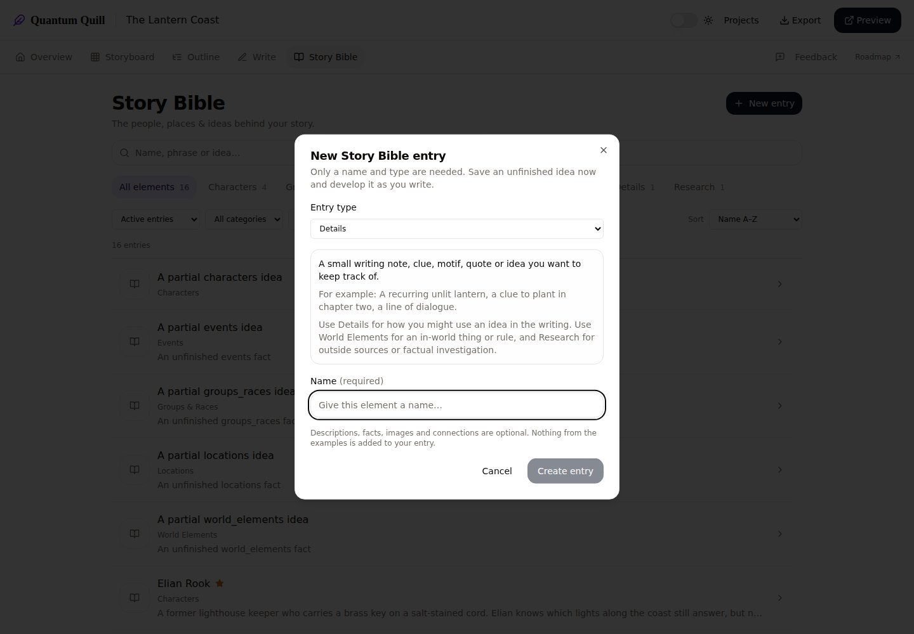
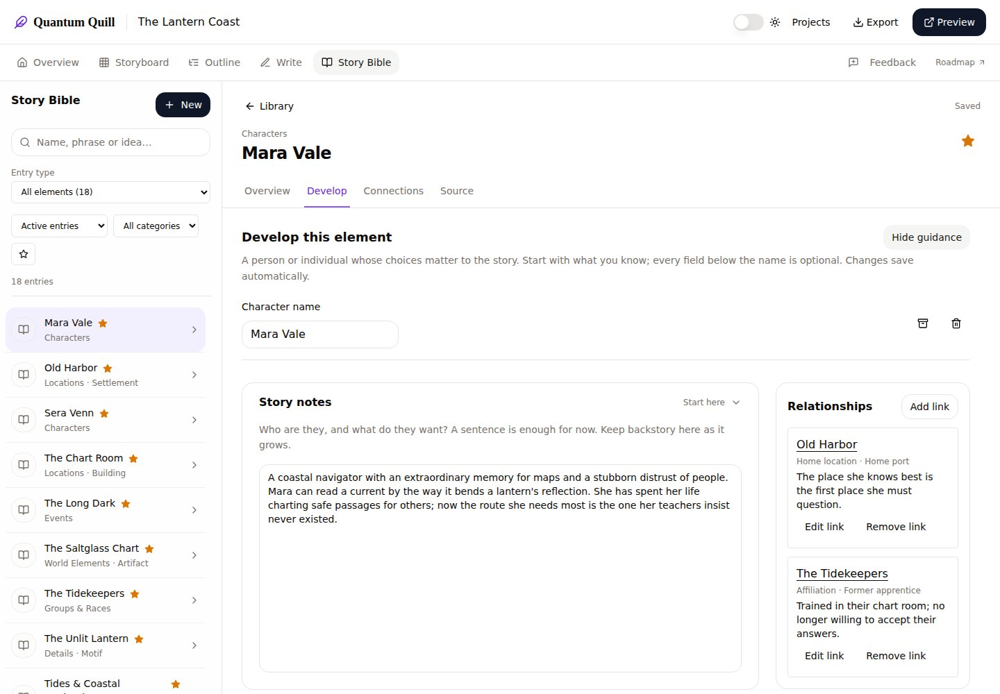
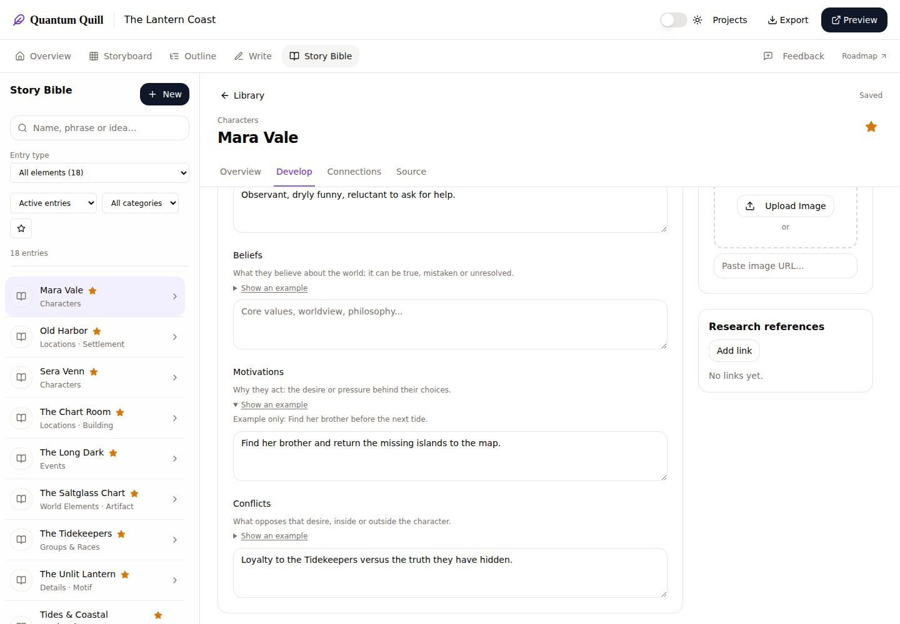
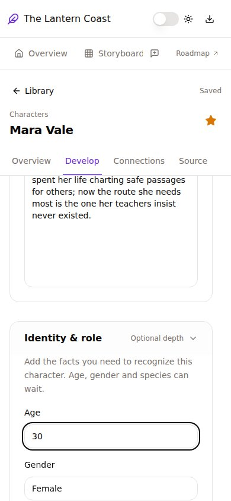

# QQ-14 — reviewed synthetic browser screenshots

Code: `a09d6d099898b843094b8127e5223898dbc1c499`. [Passing Chromium run](https://github.com/drsurfbum/quantum-quill-app/actions/runs/40136370126) · [validation receipt](../../QQ14_VERIFICATION.json) · [feature notes](../../GUIDED_STORY_BIBLE.md).

These are original captures of the actual app using the disposable in-memory **The Lantern Coast** fixture. No private writing, uploads, account details or credentials appear. Animations were settled for capture; the controls and prose were not redrawn. The desktop viewport is 1440 × 1000; the compact viewport is 390 × 844.

## Choosing a type

The selected type explains its purpose, shows concrete examples and distinguishes Details, World Elements and Research. Only a name and type are required; example text is never inserted into the entry.

## Developing a character

Story notes come first. Extra fields remain available in meaningful optional groups; guidance can be hidden. The existing Workspace tabs, connections and stable save status remain in place.

## Field help and optional examples

Brief explanations distinguish beliefs, motivations and conflicts. Opening an example leaves the authored field unchanged.

## Compact screens

The entry uses a single bounded pane; disclosure groups, fields, tabs and save status remain reachable. This capture is intentionally partway down the scrolling Develop pane.

The passing CI artifact includes seven captures, including the original Source view, optional connection picker and compact creation dialog. These four reviewed representatives are retained alongside the feature source; the full workflow artifact has a 14-day retention period.
